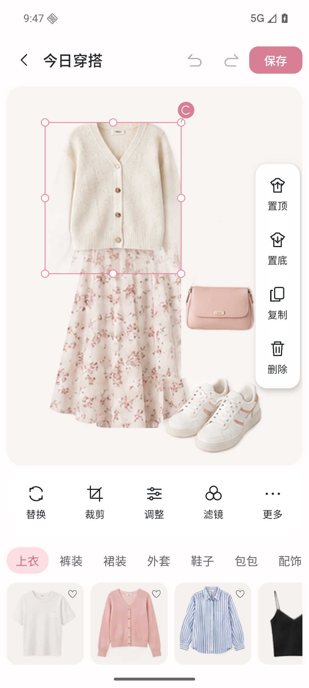
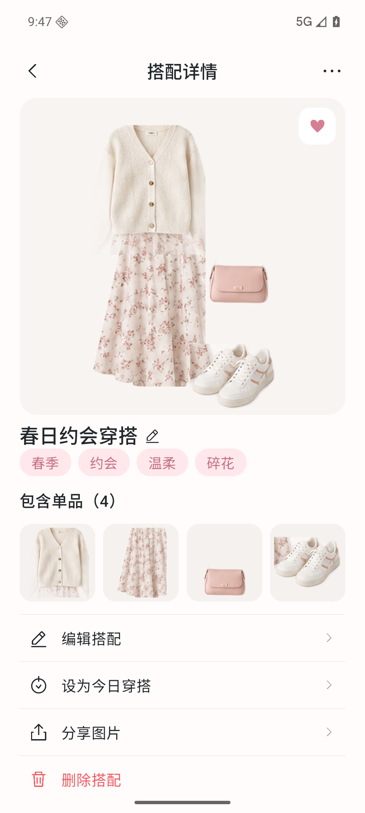

# 衣橱app

**把衣橱装进手机，把每天的搭配提前安排好。**

衣橱app 是一款免费开源的 Android 衣橱与穿搭管理应用，安装后显示为“小衣橱”。把自己的衣服拍下来，去除背景、分类收纳，再把上衣、裙裤、鞋包拖到画布里组合成一套穿搭。喜欢的搭配可以保存、继续编辑、导出图片，也可以安排到穿搭日历中。

**Android 8.0+ · 离线抠图 · 本地存储 · 无需注册**

[下载 Android 安装包](https://github.com/r1377171249/yichu-app/releases/download/v0.15.1/XiaoYiChu-v0.15.1-debug.apk) · [查看版本更新](https://github.com/r1377171249/yichu-app/releases) · [从源码构建](#从源码构建)

## 界面预览

<table>
  <tr>
    <th>挑选单品</th>
    <th>自由搭配</th>
    <th>保存与分享</th>
  </tr>
  <tr>
    <td></td>
    <td></td>
    <td></td>
  </tr>
</table>

以上为实际应用界面，使用示例衣物展示；示例内容不会预置到新安装的衣橱中。

## 可以用它做什么

### 整理衣服，找到想穿的那一件

拍照或从相册导入衣物，也可以一次添加多张照片。按上衣、裤装、裙装、外套、鞋子、包包、配饰分类，记录颜色、季节和适用场合。通过关键词搜索、组合筛选、排序和收藏，快速找出适合今天的单品。

### 去掉照片背景，保留干净的衣物素材

内置离线自动抠图，不需要把照片上传到服务器。支持裁剪、不同边缘处理模式，以及手动擦除 / 恢复；局部放大镜方便修整细节。原始照片会保留，已有衣物也可以重新处理并另存为新单品。

### 在画布上试着搭一套

选择衣物加入搭配画布，自由拖动、缩放、旋转，调整前后图层，替换或复制单品。也可以使用标准布局、裁剪和滤镜，并通过撤销 / 重做比较不同组合。保存的是可继续编辑的搭配，而不只是一张截图。

### 留住搭配灵感，安排每天穿什么

为搭配取名、添加标签或收藏，查看一套搭配由哪些单品组成，导出图片分享。穿搭日历可以区分未来计划与实际穿着记录；合集便于整理不同风格，本地规则推荐可以生成搭配候选，再放进画布调整。

### 少一点重复操作，多一份数据保护

支持批量录入、未保存草稿恢复，以及衣物 / 搭配回收站。完整备份可以导出到应用外，恢复前可查看内容，并检查是否重复导入。备份提醒帮助你定期保存自己的衣橱。

## 下载与开始使用

当前版本 **0.15.1**，支持 **Android 8.0 及以上**。

1. [下载 APK](https://github.com/r1377171249/yichu-app/releases/download/v0.15.1/XiaoYiChu-v0.15.1-debug.apk)，在 Android 手机上安装并打开“小衣橱”。
2. 在“衣橱”中点“录入衣物”，选择照片或拍照，检查抠图结果，填写名称与分类后保存。
3. 打开“搭配画布”选取单品，调整组合并保存；之后可在“我的搭配”中继续编辑或分享。

升级前建议导出备份，并使用相同签名的 APK 覆盖安装。卸载会移除应用内的数据；自行构建或 CI 生成的调试包签名可能不同。

## 使用说明

- **不需要注册账号。** 衣橱、照片和搭配保存在手机本地，核心功能可离线使用。
- **自动抠图可配合手动修补。** 通用前景模型可能保留衣架、阴影或其他物体，浅色衣物和复杂边缘可在预览后修整。
- **备份需要主动导出。** 本地存储不等于云备份，换机或卸载前请将备份文件保存到应用外。
- **本地推荐使用规则生成候选。** 可以继续调整，不提供云端 AI 试穿。

## 从源码构建

技术栈：Kotlin、Jetpack Compose、Room、ONNX Runtime、U²-Net-p。

准备 JDK 21、Android SDK Platform 36 和 Build Tools 36.0.0，在 Android Studio 中打开项目，或执行：

```sh
./gradlew assembleDebug testDebugUnitTest
```

Windows 使用 `gradlew.bat`。APK 输出到 `app/build/outputs/apk/debug/app-debug.apk`。

## 更新与许可

[更新日志](CHANGELOG.md) · [贡献说明](CONTRIBUTING.md) · [第三方声明](third_party/NOTICE.md)

原创代码采用 [MIT](LICENSE)；第三方模型与依赖保留各自许可。
