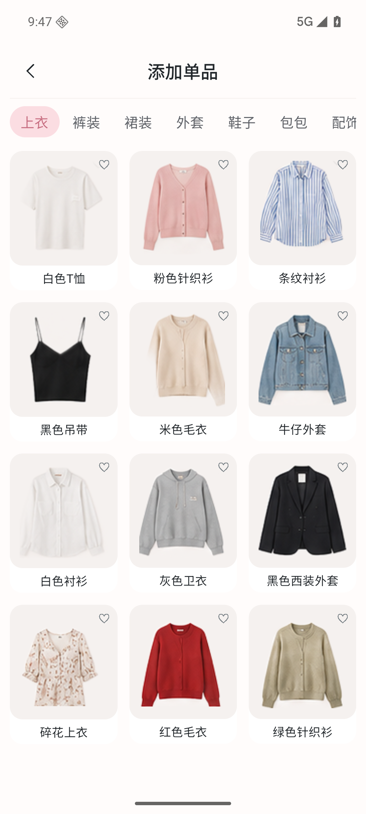
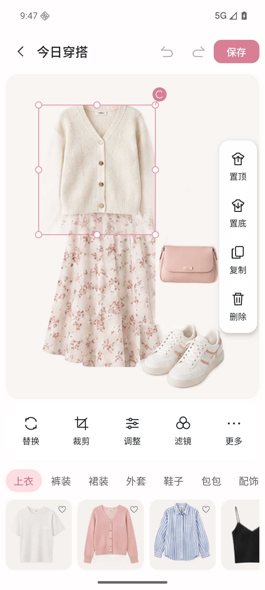
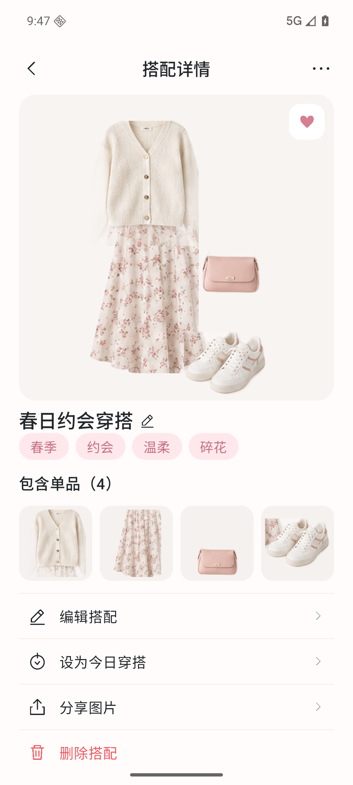

# 衣橱app 0.15.1

支持 Android 8.0+，应用包名 `com.xiaoyichu.app`，版本号 0.15.1（16）。

把衣服拍下来，整理成手机里的衣橱；去除照片背景，在画布上组合穿搭，再保存、分享或安排到日历中。免费开源，无需注册，核心功能离线可用。

## 主要功能

- **衣物收纳**：拍照 / 相册单张或批量录入，按类别、颜色、季节和场合管理，支持搜索、筛选、排序与收藏。
- **离线抠图**：自动去除背景，支持裁剪、手动擦除 / 恢复和局部放大镜，保留原始照片。
- **自由搭配**：拖动、缩放、旋转衣物，调整前后图层，替换单品；保存后仍可继续编辑。
- **搭配管理**：名称、标签、收藏、合集、单品关联，以及图片导出与分享。
- **穿搭安排**：日历区分未来计划与实际穿着记录，本地规则推荐提供可调整的搭配候选。
- **备份与恢复**：草稿恢复、回收站、备份提醒、导入预览与重复导入保护。

## 界面预览

<table>
  <tr><th>挑选单品</th><th>自由搭配</th><th>保存与分享</th></tr>
  <tr>
    <td></td>
    <td></td>
    <td></td>
  </tr>
</table>

截图使用示例衣物展示，示例内容不会预置到新安装的衣橱中。

## 本次更新

- 衣橱增加快捷“重置”，清空搜索、属性筛选和排序，保留当前分类。
- 保留原筛选弹窗的重置入口。
- 优化小屏、大字体及横屏下的控件布局。

## 安装

附件为调试 APK。升级前请导出备份，使用同签名 APK 覆盖安装。自行构建的调试签名可能不同。

APK SHA-256：`d2257a6e7282d39dbc82d0dbbcb8cdbe7c571b9f92753e288482eace8c795737`。

原创代码采用 MIT，第三方许可见 LICENSE、NOTICE 和仓库 third_party/NOTICE.md。
